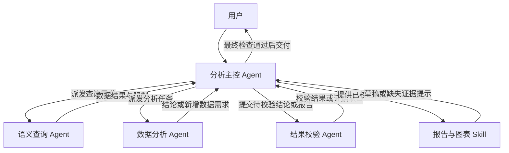

# 获客智能运营 Agent Team 产品与技术方案设计

> 修订日期：2026 年 9 月 27 日。用于课程作业讨论和后续修改。  
> 本次依据：《智能获客数据分析_AgentTeam架构设计建议.md》；业务依据沿用《智能运营项目理想态（9.24优化版）》及第 5 节课要求。  
> 本文描述拟议产品。架构协作、SQL 查询、模型效果、耗时和费用均需原型验证；示例结构不代表真实执行结果。

## 1 产品目标与架构决定

### 1.1 产品定位与能力边界

产品服务信贷信息流获客的运营、策略与分析人员。用户通过“新建会话—提问—追问”完成成本、规模、质量和策略复盘分析，获得可追溯的结论、证据、限制与建议动作。

| 问题域 | 典型问题 | 希望支持的业务判断 |
|---|---|---|
| 成本 | 腾讯／抖音 CPS 为什么上涨？成本侧与单产侧各贡献多少？ | 优先处理哪个业务环节和流量对象 |
| 规模 | 昨天巨量消耗为什么下降？预算、出价还是拿量能力发生变化？ | 决定排查顺序及需要协作的团队 |
| 质量 | 高 CPS 但质量更好的流量是否值得继续投？ | 综合成本、规模、质量和交易价值判断 |
| 其他，包括经营复盘与数据保障 | 3W2Q 提价有无效果？回传异常是否影响获客？ | 评估策略、数据或系统问题，以及下一步验证方式 |

四类问题用于识别业务目标，均调用同一套专业能力。一次任务可以跨越多个问题域，例如分析消耗下降时同时检查成本与质量。

| 能力层级 | 可处理的任务 | 输出边界 |
|---|---|---|
| 优先建设 | 有明确指标和可比数据的趋势、贡献、结构分析与候选原因验证 | 输出可复算的变化和支持程度；效果需通过评测确认 |
| 有条件支持 | 无随机对照的策略复盘、贷后尚未成熟的价值判断、缺外部数据的拿量分析 | 交付当前事实和阶段性判断，并指出尚不能回答的部分 |
| 当前不支持 | 日内实时变化、仅凭内部数据判断媒体全市场供给、自动调价／停投、模型性能的技术成因分析 | 说明范围，可引导至完整日期分析或对应责任团队 |

相较人工跨报表分析，预期价值是复用分析方法、保留证据与未解假设，减少重复核对；相较常规看板，新增围绕问题组织查询、检验解释和持续追问的能力。当前不宣称优于行业专家，也不把复杂归因全部视为可自动确定的因果关系。

首版使用模拟数据和业务说明，分析跨日、已完成日期。目标产品通过数仓 MCP 取得受控数据；课程原型可先将 CSV 映射为本地只读 SQL 表／视图，模拟同一查询接口。数仓 MCP 实际连通情况单独验收，不将本地读取表述为已经接入真实数仓。

### 1.2 专业角色与职责

采用 **1 个分析主控 Agent＋3 个专业 Agent＋共享 Skill／Tool**，形成中心协调、专业分工、按任务状态选择路径的架构。

| 初版职责 | 当前设计 | 调整理由 |
|---|---|---|
| 主 Agent 负责意图与调度 | 分析主控 Agent，继续承担意图识别、必要澄清和最终交付 | 对话理解与任务状态由同一角色维护 |
| 指标与数据 Agent | 语义查询 Agent | 明确业务需求到指标、维度、粒度、关联关系及 SQL 的完整职责 |
| 经营归因 Agent、策略评估 Agent | 合并为数据分析 Agent | 将异常、贡献、质量、价值判断和实验评估组织为同一分析过程，按问题选择方法 |
| 证据审查 Agent | 结果校验 Agent | 独立验证数据引用、分析方法、结论和建议，并检查最终呈现 |
| 报告、图表与知识能力分散描述 | 报告生成、图表生成、知识检索等作为 Skill／Tool | 统一表达与执行规范，避免增加只做固定步骤的 Agent |

常设的是四种职责，并不要求每次问题都调用四个 Agent，也不要求四套不同模型。趋势、结构、异常等分析方法归数据分析 Agent 使用；复杂任务的临时并行分析单元作为后续演进，MVP 不设常驻趋势／结构／报告 Agent。

### 1.3 架构关系



图中箭头表示任务与交付物传递，不表示固定执行顺序。各专业 Agent 不直接调用另一位专业 Agent；分析中出现新增数据需求，先返回主控，再由主控决定复用已有数据、发起查询、请求澄清或停止。

共享状态保存任务说明、执行计划及步骤状态，以及数据需求、数据结果、分析结论、校验结果和报告配置。主控一次可以派发多个无依赖冲突的任务实例；执行层异步执行、登记状态与版本。专业 Agent 内部计算不逐项提交主控审批，普通进度通知也无需每次调用主控模型。

### 1.4 产品成功指标

以下指标保留原稿的产品目标，并与第 9 章的技术评测区分。单问题以确认范围后的任务为单位；多问题分别统计子任务完成率与父请求完整交付率，父请求的全部问题得到明确处理不等于全部成功回答；部分完成、正确拒答和完整完成分别统计，不能合并成一个较高的成功率。

| 指标 | 定义与观察方式 | 当前要求 |
|---|---|---|
| 有效任务完成率 | 在数据可回答的任务中，正确回答核心问题且提供证据、限制和下一步的任务数／此类任务总数 | 人工复核后建立基线；部分完成单列 |
| 业务判断正确率 | 与人工标注一致的关键判断数／可判定的关键判断总数 | 分别统计事实、贡献、解释及建议，允许有依据的等价分析 |
| 证据越界率 | 出现无依据因果、长期收益或动作断言的任务数／已交付任务总数 | 验收集要求不出现；不据此宣称生产环境风险为零 |
| 有效澄清率 | 关键歧义得到解决的任务数／存在关键歧义的任务总数 | 同时记录不必要追问和澄清后放弃率 |
| 结论可追溯率 | 可追溯至有效数据、计算或知识版本的关键结论数／关键结论总数 | 验收集要求关键结论全部可追溯 |
| 体验与效率 | 任务耗时的中位数及 P90、主动放弃率、有帮助反馈比例、每任务费用 | 按查数／分析／调查分别统计；反馈展示参与人数，避免只看比例 |

准确率、耗时改善和费用目标在完成基线测量后制定；竞品实测耗时不作为本产品承诺。正确拒答单独检查理由是否成立，防止通过拒绝复杂问题提高其他指标。


### 1.5 为什么采用 Agent 与 Agent Team

本产品的核心是主控围绕业务目标持续规划，并根据真实查询与分析结果调整计划。真实业务中的问题表述、对象组合、策略变更、数据缺口和候选解释不断变化，完整分析路径难以事先穷举。可以预先定义方法与约束，但难以预先规定每个问题最终需要哪些查询、验证哪些解释、何时结束调查。

例如，同样询问“CPS 为什么上涨”，首次数据可能指向成本变化，也可能指向单产变化、流量结构变化或数据异常。主控应结合专业 Agent 的结果选择后续调查；发现原假设不成立时修改计划；证据不足且无可行查询时结束，并说明限制。初始计划只定义当前有依据的步骤，后续由证据推动更新。

| 规划判断 | 本项目中需要作出的决定 | 对执行的影响 |
|---|---|---|
| 目标分解 | 一条消息包含哪些独立问题，哪些共同服务一个决策 | 建立子任务、共用条件及依赖 |
| 路径规划 | 当前应核实事实、调查原因还是评估策略 | 选择专业能力和需要的证据 |
| 计划修订 | 新数据支持或推翻了什么，哪个方向值得继续 | 增加、跳过或结束分析步骤 |
| 资源安排 | 哪些工作可以并行，哪些查询可以复用 | 派发可执行任务，避免重复取数 |
| 完成判断 | 是否回答了用户目标，继续查询能否改变判断 | 交付、部分交付或说明无法确定 |

Agent 的规划自由限定在用户目标、工具权限、数据可用性和资源预算内。计划由主控维护，专业 Agent 在具体任务内自主选择查询方案、分析方法和核验方式。业务情况难以穷举是采用这种机制的动机；真正需要通过执行记录证明的是，模型确实依据中间结果作出了有效规划和调整。

采用 Agent Team 是为了把查询语义、业务分析和证据复核交给职责明确、工具权限和上下文不同的专业角色，由主控负责整体目标。专业分工有望减少职责干扰，并支持多个问题并行调查；独立校验仍须依赖证据和计算，不能将模型之间的赞同当成证明。

固定工作流（Workflow）仍适用于明确的查数、标准报表、权限校验和公式计算。工作流也能有条件分支、循环、并行甚至模型参与的任务分解，仅凭“有计划”或“有四个角色”不能证明 Agent 的价值。本方案选择让主控持续规划开放的调查任务，并由程序执行确定性的规则。固定流程、单 Agent 和 Agent Team 的质量、时延与费用须用同一批任务对照；当前不宣称已经验证 Team 更优，也不虚构从 Workflow 升级的项目经历。

## 2 用户看到的产品

配套的[交互形态示意](sandbox:/workspace/scratch/72ddd3975ced/智能运营Agent_交互形态示意.html)展示澄清、等待及结果三个状态。它是上一版的静态低保真稿，按钮不执行查询；本次新增的多问题计划卡以第 3.2 节为准，尚未同步到该页面。结果内容使用占位说明，不代表分析结果。表格中的规则仍是实现与验收依据。

### 2.1 页面与交互入口

| 页面区域 | 呈现内容 | 用户可做什么 |
|---|---|---|
| 会话区 | 新建会话、历史标题、更新时间与任务状态 | 查看、重命名、删除历史会话；首次有效任务确认后自动生成标题 |
| 输入区 | 自由提问、四类问题示例 | 提问、追问、修改条件；提交后仍可取消任务 |
| 澄清卡片 | 缺失的渠道、时间、目标及可选值 | 点选或自定义，不重复确认已经明确的信息 |
| 已确认范围 | 实际日期、对象、指标定义、比较基准及数据截至日期 | 修改条件；系统说明哪些已有结果将重新计算 |
| 进度卡片 | 当前业务动作、已完成内容和限制 | 展开查看事实性进度，取消或继续等待 |
| 结果区 | 结论、证据、必要图表、可信度依据、限制与动作 | 展开来源、继续追问、反馈、导出 Markdown；HTML 可作为下一阶段导出格式 |

会话标题由主控根据业务对象和目标生成，用户改名后不再自动覆盖。删除会话需二次确认；已导出的副本不随会话删除。MVP 的这些交互先在原型中验证，不将未实现功能写成现有能力。

**本模块技术实现**：主控生成会话标题和业务状态摘要；前端组件展示会话与操作入口，服务端保存会话、标题及版本。会话管理 Tool 执行重命名与删除，权限检查由程序完成。本模块无需独立 Agent 或新增知识库。

### 2.2 澄清卡片示意与提交规则

用户输入“腾讯／抖音最近 CPS 为什么涨？”，展示以下信息：

| 请确认分析范围 | 选项或说明 |
|---|---|
| 分析对象，单选 | 腾讯／抖音／两者分别看 |
| 时间范围，单选 | 近 3 个完整日／近 7 个完整日／近 14 个完整日／自定义 |
| 比较基准 | 默认上一段等长时期，可修改 |
| 数据说明 | 转化成熟窗口另行核对；近 7 日不代表 T7 |
| 操作 | 确认并分析／取消；自定义日期无效时提示具体字段 |

卡片只呈现当前缺失项。点击确认后，主控将选择写入标准任务并显示实际起止日期；用户的自由文本修正同样生效。连续两轮澄清仍无法确定时，给出可分析的具体问题示例，暂停受影响问题的取数，不继续无上限追问；其他独立问题继续。

相对日期按用户时区解析，并显示分析日和数据可用日。不能将缺失的“昨天”悄悄改成最近可用日。对于“昨天巨量消耗为什么下降”，分析对象保持昨天，历史基线可用此前 7 个完整日的日均值；为寻找趋势起点，可以额外观察更长历史，但需说明用途。

**本模块技术实现**：分析主控结合当前任务及指标定义知识识别缺失项，输出卡片字段；前端采用固定组件渲染，日期与必填值由程序校验。确认后写入任务说明。完整判断规则与 Prompt 见第 3.1 节。

### 2.3 等待状态

进度来自实际任务事件，展示业务动作及结果，不展示各 Agent 的原始推理文字。以下仅为展示示意：

| 业务步骤 | 状态示例 | 用户看到的内容 |
|---|---|---|
| 确认范围 | 已完成 | 已确认渠道、实际日期与比较基准 |
| 核对数据 | 已完成 | 已取得成本和规模数据；贷后质量尚未成熟 |
| 分析影响环节 | 进行中 | 正在比较授信成本和授信单产 |
| 获取新增证据 | 按需出现 | 需要客群结构数据，以判断是否由流量结构变化解释 |
| 核对结论 | 待开始／进行中 | 检查主要判断及建议是否有足够证据 |

步骤可重复或被跳过，不给出虚假的固定百分比。触及预先配置的耗时上限时，展示已完成事实和未完成部分，提供“继续等待／查看阶段性结果／停止”选项。阶段性结果必须标明是否已校验。

多问题请求按问题分别显示步骤和状态，允许同时出现多个“进行中”。计划调整时展示具体变化，例如“新增客群结构检查”；不将完整推理文字作为进度内容。一个问题待澄清或失败时，其他独立问题继续。

**本模块技术实现**：执行计划及步骤状态驱动进度组件；事件记录 Tool 更新实际开始、完成、失败和取消状态。主控仅在需要规划决策时被调用，前端刷新无需重新调用模型。并行机制见第 3.2 节。

### 2.4 结果页与反馈

| 结果区域 | 展示规则 |
|---|---|
| 一屏结论 | 直接回答业务问题；证据不足时可以回答当前无法判定 |
| 关键证据 | 当前值、基线、变化、样本、成熟情况；绑定数据与计算引用 |
| 分析过程 | 主要影响因素、已排除解释、待验证假设，默认简洁、可展开 |
| 图表 | 通常 1～3 张必要图表；简单查数允许 0 张 |
| 可信度与限制 | 高／中／低或无法判断，并分别说明数据、样本、成熟度和证据强度 |
| 建议动作 | 处理对象、责任方、观察窗口、核心／保护指标及重新评估条件 |
| 来源与追问 | 数据截至日期、指标版本、查询与知识引用；至多 3 个相关追问 |
| 用户反馈 | 点赞；点踩选择理解错误／数据错误／结论过强／建议无用／表达不清／其他，可添加文字 |

反馈关联当前任务和结果版本，可取消或修改；不因一次反馈自动改写全局知识。结果重新计算后保留旧版供对照。语气专业、简洁，指出假设与数据不符时给出具体证据，不使用责备式反问。

多问题交付逐项对应原问题，区分完整回答、部分回答、待澄清和无法完成。已校验且无其他依赖的结果可提前展示；整体建议所需证据未齐时保持待完成。整体请求仅在每个问题都有明确处理状态后结束，不能遗漏未回答的问题。

**本模块技术实现**：主控组织交付，报告与图表 Skill 负责呈现，结果校验 Agent 负责证据与表达检查；反馈 Tool 关联请求、子任务及结果版本。反馈记录用于评测和后续维护，不自动更新业务知识库。生成规则见第 4 章。

## 3 核心产品模块与对应技术实现

每个产品模块采用“产品形态—场景策略—输入输出—Prompt—本模块技术实现”的结构，产品设计后紧接负责实现它的 Agent、Skill、Tool 与知识库。产品模块与 Agent 不要求一一对应：需求理解和任务规划由同一个主控负责。第 6、7 章只集中说明跨模块共用的状态与运行规则，避免每节重复。

| 角色 | 要作出的独立判断 | 主要交付物 | 职责边界 |
|---|---|---|---|
| 分析主控 Agent | 是否需要澄清、下一步派发谁、是否继续投入分析 | 标准任务、派发决定、最终回答 | 唯一面对用户；不自行编造业务结果 |
| 语义查询 Agent | 指标语义、数据来源、关联方式和查询粒度是否正确 | 查询计划、数据结果说明与引用 | 不输出经营原因或策略建议 |
| 数据分析 Agent | 用什么方法、验证什么假设、证据是否足够 | 结构化结论、新增数据需求、建议及限制 | 不直接调用查询 Agent，不自行更改已确认任务 |
| 结果校验 Agent | 数字、方法、可比性、结论和动作是否得到证据支持 | 通过、带限制通过、待补充或阻断 | 不以另一套无来源判断替换原分析，不直接联系用户 |

### 3.1 需求理解与必要澄清

**产品形态**：澄清卡、已确认范围、业务进度和统一结果页。

| 场景 | 产品策略 | 下一步 |
|---|---|---|
| 问题完整 | 提取目标及条件，显示默认基线 | 有数据则复用，否则派发查询 |
| 目标或范围模糊 | 只询问会明显影响结论的条件 | 用户确认后建立或更新任务 |
| 简单查数 | 请求明确指标并保留来源 | 数据检查通过后直接答数，不启动完整分析团队 |
| 继续追问 | 保留有效数据、结论与未解问题 | 按新问题选择分析或新增取数 |
| 修改条件 | 增加任务版本，标记受影响结果失效 | 只重做受影响部分 |
| 新任务 | 建立新任务 ID，不继承上题结论 | 重新判断必要条件 |
| 专家提出新增数据需求 | 检查与目标的关系、是否已有结果、范围和剩余预算 | 复用／派发查询／要求具体化／停止 |
| 校验发现问题 | 根据问题类型判断应重新取数、重新分析还是限制结论 | 指派相应专家修正具体问题 |
| 已无可改变结论的新证据 | 结束继续探索，保留限制 | 生成完整或部分结果 |

会话关系统一为 `CONTINUE / MODIFY / NEW_TASK`。一条消息可能同时修改已有子任务并提出新问题，需逐项确定目标任务和关系，不能用单一标签覆盖整条消息。概念解释作为消息类型处理：解释“CPS 怎么算”时保留当前任务，不新增第四种任务关系。必要字段随任务类型变化：简单查数不强制要求比较基准，策略复盘则需要策略对象、变更和观察区间。

新增查询以一批清晰的数据需求为单位，不限制为每次一个指标；主控可以合并相同范围的请求。主控管理跨专家派发和资源预算，专家在已授权的任务内自行安排计算、探索及工具调用。

**输入输出**：用户消息、当前状态和专家交付物 → 任务说明（`TaskSpec`）、派发决定、报告配置（`ReportSpec`） 或澄清卡。

**Prompt 草案**：

```text
角色：你是获客智能运营的分析主控，负责理解目标、必要澄清、专家调度和用户交付。
输入：本轮消息、当前 TaskSpec、数据与结论引用、校验结果、专家能力和资源预算。
任务：
1. 判断 CONTINUE、MODIFY 或 NEW_TASK；识别概念解释、查数、分析及决策需求。
2. 提取实际日期、渠道、客群、指标、基线及限制，记录信息来源。
3. 仅对影响结果的缺失条件生成选项卡；不重复追问已确认内容。
4. 识别多个问题及相互依赖，形成可更新计划；只对受影响问题澄清。
5. 根据当前证据和计划选择一批可执行动作，可并行查询、分析或校验，不固定全局顺序。
6. 收到 DataNeed 时检查价值、范围、重复性和预算；先考虑复用或合并查询。
7. 校验指出问题时，派发具体修正任务；新证据无法改善结论时停止。
8. 报告只使用允许发布的结论和限制；完成呈现一致性检查后交付用户。
约束：近 7 日不等于 T7；不得静默替换日期或渠道；不接受失效版本结果；
不得绕过数据阻断或结果校验，不把模拟数据和未执行的计划写成真实效果。
输出：逐项任务关系、任务说明或澄清卡、计划版本与变更、可派发动作列表及理由、资源约束、需保留的限制。
```

**本模块技术实现**：分析主控 Agent 负责语义理解与必要澄清；知识检索 Skill 按需读取指标定义、业务名称及有效上下文；日期解析、字段校验与卡片渲染由 Tool／程序完成。任务说明保存确认后的目标，规划与调度沿用同一主控，详见下一节。


### 3.2 多问题规划、并行执行与计划更新

**产品形态**：用户提问后，在会话中展示简洁的计划卡，按问题列出当前步骤、状态及需要用户提供的信息；执行过程中更新，不要求用户逐步批准普通分析动作。简单查数可省略完整计划卡，直接展示查询状态。

以下用一次提出三个问题演示，日期仍按用户时区转换并逐项核对：腾讯 CPS 为什么上涨、昨天巨量消耗为什么下降、3W2Q 提价应该保持还是回滚。若部分问题缺少日期，先澄清对应问题，其余已明确问题可继续。

| 计划卡中的问题 | 初始安排 | 执行中可能看到的状态 |
|---|---|---|
| 腾讯 CPS 上涨原因 | 核对范围与成熟度，取得成本及单产数据，分析贡献与候选解释 | 正在分析；需要时新增客群结构检查 |
| 巨量昨日消耗下降原因 | 核对昨日完整性与历史基线，取得预算、Bid 及拿量证据 | 正在查询；数据缺失时显示具体限制 |
| 3W2Q 提价效果与动作 | 核对实际生效、覆盖对象及实验条件，再决定评估方法 | 正在核对执行；未生效则结束效果评估 |
| 分项校验与交付 | 每个问题具备结论后独立校验，最终说明全部问题的处理状态 | 一项已完成、其他继续；综合建议等待所依赖结论 |

表格是界面内容与调度设计示意，不是实际进度或预设结论。

| 场景 | 产品规则 | 用户体验 |
|---|---|---|
| 一个明确的查数问题 | 用简短计划直接查询，不启动不必要的分析环节 | 尽快显示数字、单位、范围和来源 |
| 一次提出多个独立问题 | 建立父请求及多个子任务；识别可共用数据，派发已具备条件的工作 | 分项进度，一项完成后可以先看结果 |
| 多个问题服务同一个决策 | 标出必要依赖，先开展独立调查 | 说明整体建议仍在等待哪些结果 |
| 一个问题缺少信息 | 仅暂停依赖缺失信息的步骤；共用字段只问一次 | 其他独立任务继续，不整批等待 |
| 收到新证据或专家数据需求 | 判断是否增加、替换、跳过或结束步骤 | 展示计划调整及简短理由 |
| 用户要求优先某一问题 | 在预算内调整待执行步骤的优先级，不绕过必需依赖 | 优先问题先处理；说明已运行任务的状态 |
| 用户修改条件 | 更新受影响子任务的版本及依赖；其他子任务保持有效 | 明确哪些结果重新计算 |
| 一项失败或证据不足 | 记录该项状态与限制，继续独立工作 | 最终逐题交代，不能把部分完成标成全部完成 |
| 用户取消 | 支持取消指定问题或整个请求；停止其依赖步骤 | 保留已完成结果，说明取消范围 |

**规划粒度**：主控管理业务目标、专业任务和依赖；专家在授权范围内安排具体计算、查询修正和验证。主控不预先列出所有 SQL 和全部计算，也不要求每个内部动作都返回。计划中的步骤描述“检查什么、取得何种证据”，不得把“证明预算不足”等未经验证的结论设为完成目标。

**执行原则**：有真实依赖的步骤等待其必要输入，无依赖的步骤在资源允许时并行。同一专业角色可有多个任务实例，各自保留上下文。也可以同时运行不同角色，例如腾讯的数据分析与巨量的语义查询。每个问题取得自己的有效数据后即可进入分析，不设置“所有查询全部结束才能分析”的全局等待条件。

**输入输出**：一条或多条用户目标、已有任务、数据与专家结果 → 子任务说明、执行计划、可派发动作、计划变更理由、分项交付状态。执行计划属于共享状态，字段与示例见第 6.7 节。

**主控规划 Prompt 草案**：

本段与第 3.1 节组成同一主控的职责说明，按模块分开展示便于评审；实现时可合并为同一套指令，不要求每个请求固定调用两个规划模型。

```text
这是分析主控的规划职责，与需求理解共用同一角色。
输入：用户目标、父请求与子任务、当前计划、有效证据、专家结果、权限及资源预算。
1. 逐项识别问题，确定任务关系、必要条件、交付要求和用户优先级。
2. 建立可更新的初始计划，写明步骤目的、负责角色、前置依赖及完成条件。
3. 找出当前可以执行的步骤；合并可复用查询，返回一批授权动作。
4. 收到有决策价值的结果后判断继续、修改计划、澄清、校验或结束。
5. 一项阻塞时继续独立任务；每个问题的结论都要对应自己的证据和校验状态。
6. 计划改变只重做受影响部分，保留有效成果；明确未回答、取消和无法完成的项目。
约束：计划可以改变但不能静默改变用户目标；不得绕过依赖、权限、校验及预算。
输出：计划及版本、变更理由、可派发动作列表、等待原因、已完成与未完成问题。
```

**本模块技术实现**：

| 能力 | 实现与职责 |
|---|---|
| Agent | 分析主控规划和修订任务；专业 Agent 处理各自实例，不新增规划 Agent |
| Skill 与知识库 | 主控按需检索分析方法的适用条件、指标说明与专家能力说明，辅助规划；模板不能代替证据判断 |
| Tool／程序 | 校验任务依赖、权限和预算；异步派发、并发限额、队列、事件登记及取消；主控无需等待某个实例完成后才能批准其他任务 |
| 状态 | 保存父请求、子任务、计划版本、步骤状态、输入输出引用与完成条件；普通进度事件直接更新状态 |
| 唤起主控的时机 | 新用户目标、关键结果、需要新数据、校验退回或计划受阻；已批准且条件满足的步骤由程序直接执行 |
| 校验与聚合 | 分项结论按各自证据版本校验；整体建议只使用全部必要依赖已就绪的内容 |

并发数是可配置参数，原型可先以全请求最多 3 个在途专业任务作为测试初值，并服从模型、查询服务及全局资源上限；该初值不代表最优配置。技术运行细则见第 7.2 节。

### 3.3 数据准备与质量检查

**产品形态**：折叠的“指标与数据范围”卡片；缺数或定义冲突时展示明确原因和受影响结论。

完整职责为：理解数据需求，确定指标、维度、日期、过滤条件、统计粒度，检索指标及元数据，选择表和关联关系，形成查询计划，生成并校验 SQL，执行只读查询，检查质量，保存结果和来源。

| 场景 | 查询与质量策略 | 交付要求 |
|---|---|---|
| 业务名称存在多个定义 | 检索指标字典，说明差异；无法确定时返回主控 | 不凭字段名称猜测，不自行采用新定义 |
| CPS 一级拆解 | 同一范围获取消耗、授信人数和首借金额 | 返回分子分母、计算关系及可比性 |
| 跨表查询 | 明确各表粒度、主键、连接方向和去重规则 | 检查连接前后行数及重复，避免金额被放大 |
| 时间范围明确但数据不覆盖 | 保留用户请求日期与实际覆盖日期 | 不自动将日期移动到最近可用日 |
| 新近日期需要 T7／T15 | 检查每批样本观察窗口 | 不可比时阻断相应比较；可用指标继续返回 |
| 策略复盘 | 读取变更、实际执行、覆盖对象及分组记录 | 返回是否有执行证据与分组事实；因果方法由分析 Agent 判断 |
| SQL 错误或超时 | 返回错误类型和修正方案；按主控预算进行有限重试 | 不将空结果解释为业务为零，不绕过权限 |
| 无数据或结果异常 | 区分真实零值、缺失、未更新、过滤无匹配及执行失败 | 给出受影响字段与允许使用的结果 |

本项目 CPS = 消耗 ÷ 首借金额。在相同日期、人群和归因规则下，授信成本 = 消耗 ÷ 授信人数、授信单产 = 首借金额 ÷ 授信人数，才可推导 CPS = 授信成本 ÷ 授信单产。参考架构中的 CPA 仅是协议示例，本方案不据此替换原项目指标。

每份查询计划写明：要回答的数据问题、指标定义版本、表与字段、连接及去重方式、聚合粒度、日期与过滤条件、预期检查项。SQL 静态校验负责只读权限、允许的表字段、日期条件和执行限制；这些检查通过不等于业务语义正确，语义及结果仍需核对。

**输入输出**：任务说明（`TaskSpec`）＋数据需求（`DataNeed`）＋指标／元数据知识 → 数据结果说明（`DataResult`）。结果至少包含指标定义、数据范围、粒度、SQL／查询计划引用、行数、样本量、覆盖、新鲜度、成熟情况、质量检查和文件引用，不仅返回数据表。

质量检查用 `READY / PARTIAL / BLOCKED`。样本量阈值按指标、用途和历史波动标定；未标定时显示样本规模及不确定性，不自动声称充分。数据文件只是传递载体，实际表名、字段名和关联键必须来自元数据。

**Prompt 草案**：

```text
角色：你是语义查询 Agent，负责将业务数据需求转成可追溯、可复算的只读查询。
输入：TaskSpec、DataNeed、指标字典、数仓元数据、已验证查询样例和可用工具。
任务：
1. 明确指标、维度、日期、过滤、粒度，检索定义及表字段关系。
2. 形成查询计划；检查跨表关联、重复记录和分子分母的统计范围。
3. 生成 SQL，调用静态校验；通过后按授权执行并检查结果。
4. 保存结果、查询和质量检查引用；如无法满足需求，返回具体缺口。
约束：不编造表字段和关联键；不修改数据库；不静默改变用户范围；
未成熟、缺失及真实零值分别标记；不输出经营原因或策略建议。
重试必须在主控授权的预算内；需要改变数据需求时交主控重新确认。
输出：DataResult、READY／PARTIAL／BLOCKED、可用结果、受限用途及下一步所需信息。
```

**本模块技术实现**：由语义查询 Agent 调用指标／元数据检索 Skill、SQL 校验 Tool、只读执行 Tool、数据质量检查 Tool 和结果存储；知识来自指标字典、表元数据与已验证 SQL 样例。目标数据执行入口为数仓 MCP；模拟版使用相同数据需求与结果结构，生产连接需单独验证。

### 3.4 业务分析与建议形成

**产品形态**：趋势与贡献图、候选原因验证表、价值比较表、策略效果和建议卡片。

本 Agent 统一负责成本、规模、质量的分析，以及流量价值和策略效果评估。它可以探索已有数据、提出假设、选择方法、计算、比较、继续下钻或停止；经营归因与策略评估不再作为两个常设 Agent。

| 场景 | 可选择的分析方法 | 继续或停止条件 |
|---|---|---|
| CPS 异动 | 趋势确认、成本／单产拆解、客群或版位贡献 | 优先调查影响较大且结果可靠的部分；主因不清时保留多个候选 |
| 巨量消耗下降 | 历史基线、预算／Bid 假设验证、我方竞价链路分析 | 缺外部数据时停止对媒体全市场供给的判断 |
| 质量指标下降 | 人群结构、模型分档、前后业务环节与变更关联 | 定位受影响对象；不能据此独立确定模型技术成因 |
| 高 CPS 高质量 | 成本、规模、质量与交易价值比较；稳定性及静态剔除测算 | 贷后未成熟时限制长期收益；静态结果不当成未来投放预测 |
| 调价效果复盘 | 执行核验、随机实验评估或观察性前后／同期比较 | 未生效则不评估效果；无可靠随机对照时限制因果表达 |
| 因素相互抵消 | 分别展示增加项、抵消项与净变化 | 总变化接近零时不强算贡献百分比 |
| 缺新维度或记录 | 提出具体 DataNeed，保留已验证内容 | 等主控返回数据，不自行调用语义查询 Agent |
| 已有足够证据或无法继续 | 汇总事实、待验证解释和建议限制 | 明确结束理由，交主控校验或部分完成 |

业务分析方法保留以下具体要求：

- CPS 成本侧可继续检查首登、申完、授信等环节；单产侧检查额度、发起、使用及动支，再结合客群／版位／账户组判断贡献。每个拆解公式以有效指标定义为准。
- 巨量消耗问题在验证预算与 Bid 后，可检查 pCTR、pCVR、曝光、素材及回传等实际可用证据；竞价机制用于提出假设，不能代替证据或直接套用到所有出价方式。
- 流量价值比较按可用数据同时观察 CPS、消耗、安全过件率、首借单产和 1–3 级交易占比；这些前端指标不能代替成熟贷后收益。静态剔除只描述当前结构下的结果。
- 策略效果同时检查规模指标、效率指标及质量保护指标；给出保持、回滚或扩量验证的条件，不能把“没有回滚依据”直接推成“可以扩大”。

“影响较大”需要同时考虑变化幅度、对象规模和对总体的贡献。排序前检查样本与稳定性；结果不可靠时不强行选出唯一主要因素。异常判断应说明所用基线与历史波动依据，不能只把涨跌方向当成异常。

**CPS 一级贡献的计算规则**：建议默认采用两种替换顺序取平均的两因素分解，减少替换先后顺序对归属的影响。令授信成本为 C、授信单产为 Y，0 表示基线、1 表示当前，且两期 Y 均大于零：

- 成本侧贡献 = (C1 − C0) × (1/Y0 + 1/Y1) ÷ 2。
- 单产侧贡献 = (C0 + C1) × (1/Y1 − 1/Y0) ÷ 2。
- 两者之和必须等于 CPS1 − CPS0。它是指标恒等式分解，不能单凭贡献值确认业务原因。

贡献先展示 CPS 的绝对变化量。若两侧相互抵消，明确展示正负贡献，比例可能超过 100%；净变化接近零时省略比例，判定精度与指标展示精度一致。零分母或统计范围不一致时停止该分解。下钻到客群后仍按总体分子、分母重算，不直接平均各客群 CPS。

在已取得的数据内，专家可以连续完成多个计算与假设验证，无需每个动作都返回主控。只有需要新增源数据、改变范围、澄清目标、达到停止条件或资源限制时才交接。新增 DataNeed 必须说明“缺什么、验证哪个解释、结果将怎样改变结论或建议”，主控决定是否查询。

**输入输出**：任务说明（`TaskSpec`）＋数据结果说明（`DataResult`）＋业务知识及当前分析状态 → 分析结论（`Finding[]`）、数据需求（`DataNeed[]`）或停止说明。Finding 区分数据事实、因素贡献、相关解释、因果判断和建议，并绑定数据及计算引用。

**Prompt 草案**：

```text
角色：你是获客数据分析 Agent，负责分析变化、验证解释并评估经营动作。
输入：TaskSpec、经检查的 DataResult、业务知识、已有假设、计算结果和资源限制。
任务：
1. 确认当前问题及数据可回答范围，自主选择趋势、贡献、结构、情景或实验方法。
2. 在现有数据内循环提出假设、计算和核验，记录支持、不支持、尚缺证据的解释。
3. 价值判断同时考虑成本、规模、质量和交易；策略复盘先核验实际执行及实验条件。
4. 需要新增数据时输出 DataNeed，说明判别价值；不要直接调用其他专业 Agent。
5. 新分析无法改变结论或建议、缺数据无法解决、达到预算时，提交阶段结果与停止理由。
约束：所有数字来自计算；同向变化不等于因果；未成熟贷后不证明长期收益；
静态剔除不预测实际关停效果；不编造扩量后表现；不输出无证据的素材疲劳结论。
输出：Finding 列表、证据引用、假设状态、限制、图表需求、DataNeed 或停止理由。
```

**本模块技术实现**：数据分析 Agent 使用 Python 数据处理及计算 Tool，趋势、贡献、假设验证、结构分析、静态测算和实验评估 Skill；按需检索获客业务机制、指标定义与策略知识。分析方法需保留适用条件；是否使用某方法由任务与证据决定。

### 3.5 结论校验与发布限制

**产品形态**：结果中的可信度依据、限制和来源；需要重新核对时展示业务进度。用户无需查看内部争论。

| 校验对象 | 核查要求 | 不符合时的处理 |
|---|---|---|
| 时间与样本 | 日期完整、成熟窗口一致、比较范围可比 | 请求新数据或限制相应结论 |
| 指标与计算 | 定义、粒度、分母、贡献公式及数值能复算 | 返回计算问题，必要时重算关键项 |
| 实验有效性 | 有随机分组证据，执行与观察条件支持当前方法 | 无法支持时改为观察性解释或重新分析 |
| 结构与同期因素 | 客群、渠道、素材及其他策略变化是否影响解释 | 指出未排除解释和需要的数据 |
| 证据覆盖 | 主要结论均有对应数据、计算或有效业务知识 | 删除无依据结论，或请求补充证据 |
| 建议 | 动作强度、适用范围与证据和权限一致 | 调整建议或明确目前无法判断 |
| 最终报告 | 数字、单位、图表、结论及限制与已校验内容一致 | 退回报告修正；新增结论必须重新校验 |

语义查询检查数据是否可用；结果校验检查这些数据和方法是否支持具体判断。校验方可访问原始结果引用，并调用计算工具复算关键值。另一位模型的赞同不等于独立证据。

| 校验状态 | 含义 | 主控处理 |
|---|---|---|
| `PASS` | 待发布内容有支持，必要限制已体现 | 允许用于报告 |
| `PASS_WITH_WARNING` | 有效内容可发布，但必须附带明确限制 | 报告保留限制；unsupported_claims 不可发布 |
| `NEED_DATA` | 存在影响核心结论的数据缺口 | 评估新增查询价值，交语义查询 Agent |
| `NEED_ANALYSIS` | 数据已有，但计算、方法或逻辑需修正 | 交数据分析 Agent 定向修正 |
| `BLOCKED` | 核心结论当前不成立或数据不可用 | 阻止该结论；其他独立有效结论可部分交付 |

带限制通过时，明确列出允许发布的 Finding ID、限制和禁止使用的说法，不以一句“低可信度”掩盖无证据断言。报告生成后再次检查最终版本；若仅重排版式，可用一致性规则核对，出现新措辞或判断变化则由校验 Agent 复核。

可信度分别针对具体结论评估，不将四项检查简单平均。数据完整、计算可复算、样本和成熟规则满足且证据一致，可以支持较高可信度的数据事实；同一报告中的因果或长期收益判断仍可为无法判断。

**输入输出**：任务说明（`TaskSpec`）＋数据结果说明（`DataResult`）＋分析结论（`Finding[]`）及拟交付内容 → 校验结果（`VerificationResult`）。专业 Agent 无权自行绕过未通过的结论。

**Prompt 草案**：

```text
角色：你是独立的结果校验 Agent，判断拟发布结论是否得到数据与方法支持。
输入：任务版本、数据说明与结果引用、Finding、计算记录，以及本次待校验内容。
任务：逐项检查日期、粒度、成熟度、样本、可比性、结构变化、关键计算、
结论一致性、因果边界与建议；必要时复算关键值。区分缺数据与分析错误。
报告阶段另外检查数字、单位、图表和限制是否与允许发布的结论一致。
约束：不新造事实，不重写用户目标，不以语言流畅代替证据；
不能把模型之间的一致意见视为因果证据；不得静默放行无来源结论。
输出：VerificationResult，包含状态、允许发布的 Finding ID、限制、
不支持的说法、需要的数据或分析修正，以及应交主控的下一步建议。
```

**本模块技术实现**：结果校验 Agent 使用独立任务上下文、证据读取、计算复核和报告一致性检查 Tool，按需检索有效指标定义及方法适用条件；校验规范以 Skill 复用。按关键结论复核，无需机械重做所有查询和分析。

## 4 图表与报告呈现及对应技术实现

本章从用户收到的图表和报告出发，先定义呈现规则，再说明生成与检查的实现。跨模块复用的能力汇总见第 4.3 节。

### 4.1 图表规范

| 表达目的 | 优先形式 | 具体规范 |
|---|---|---|
| 时间变化与起点 | 折线图 | 显示实际日期，缺失值不补成零，基线与策略生效日须有依据 |
| 对象比较 | 横向条形图或指标表 | 使用一致分母与窗口；排序时同时显示样本及规模 |
| 因素贡献 | 贡献表／条形图 | 标明增加项与抵消项；净变化接近零时展示绝对量 |
| 策略前后／组间比较 | 对照表或分组图 | 明确“随机实验”或“观察性比较”，不混用组别身份 |
| 候选原因验证 | 验证表 | 支持／不支持／缺证据，并附结果引用 |

中文指标名；金额按元／万元，比例用 %，比例差用 pp，CPS 按业务定义展示。当前与基线用蓝、灰区分，橙色标限制；涨跌不直接等同好坏。主结论突出显示，详细计算和来源默认折叠。图表失败时保留可信数字表，不阻断文字结果。

图表类型优先按上述规则选择；数据分析 Agent 可以根据目的提出变更，但需说明理由。图表配置记录数据来源、横纵轴、分组、筛选、单位、标题及支持的 Finding ID，绘图 Skill 不另行猜测这些条件。

**本模块技术实现**：数据分析 Agent 提出图表需求，主控或报告 Skill 调用统一图表 Skill；绘图 Tool 读取指定数据与配置生成图表。指标名称及单位来自指标字典，样式来自统一规范，绘图过程无新增取数或分析权限。

### 4.2 报告生成及最终检查

业务分析类任务的交付顺序为：分析结论校验通过 → 主控形成 ReportSpec → 报告与图表 Skill 生成草稿 → 检查最终报告与已校验结论的一致性 → 主控交付。

报告 Skill 发现缺证据时，返回 `MissingEvidence`，包含对应结论、缺失内容和受影响区块，由主控决定重新查询、分析或删除该部分。报告 Skill 不绕过主控向专业 Agent 派任务。

报告阶段如新增或强化了判断，原校验状态不自动延续，须由结果校验 Agent 复核。校验通过的范围绑定具体 Finding 版本和报告版本，之后改变关键内容需重新检查。

**报告 Skill 的表达约束**：

```text
只使用 ReportSpec 指定的、已获准发布的 Finding 与数据引用。
按结论、证据、限制、动作组织内容；保留所有强制限制。
可压缩文字和调整版式，不新增事实、因果关系、预测或动作依据。
需要图表时使用指定数据与图表配置；需要新证据时返回 MissingEvidence。
不直接查询数据库，不自行委派其他 Agent。
输出报告草稿、所用 Finding ID／版本、图表引用和缺失证据提示。
```

简单查数使用直接答数模板，仅展示经质量检查的原值、单位、范围和来源，不生成趋势或经营结论，因此可以跳过完整分析与模型校验阶段。

**本模块技术实现**：主控形成报告配置，报告 Skill 组织内容、调用图表 Skill；一致性检查 Tool 校验可确定的数值和引用，语义变化交结果校验 Agent。报告只读取已授权的结论、数据与已核实的知识引用，不独立检索新证据推导新判断。多个问题分别形成可发布内容，再按父请求组织最终回答。

### 4.3 共享能力与权限对照

Skill 封装可复用的方法、规范与操作说明，Tool 执行查询、计算和文件等具体动作。Skill 可以包含模型参与的表达任务；精确数值与权限约束由工具校验，不将所有 Skill 都描述成确定性程序。

| 能力 | 由谁调用 | 输入与交付 | 约束 |
|---|---|---|---|
| 知识检索 Skill | 主控及专业 Agent | 查询意图 → 有版本和来源的知识片段 | 检索不到就说明缺口；业务解释不能代替事实数据 |
| SQL 校验 Tool | 语义查询 Agent | SQL、查询计划与权限 → 校验结果 | 未通过不得执行 |
| 数仓 MCP／只读查询 Tool | 语义查询 Agent | 已校验查询 → 数据与执行信息 | 只读、受控表字段及查询预算；模拟入口需标明 |
| Python 处理与计算 Tool | 数据分析、结果校验 Agent；数据质量检查按需调用 | 数据引用、参数与方法 → 数值及计算引用 | 禁止凭自然语言补出计算结果 |
| 分析方法 Skill | 数据分析 Agent | 任务、数据与适用条件 → 方法说明及计算步骤 | 包含趋势、贡献、结构、情景和实验方法，不新增常设专家 |
| 图表生成 Skill | 数据分析提出图表需求，由主控或报告 Skill 调用 | 数据引用、图表配置 → 图表文件及引用 | 无自行取数权限；必须保持指标、单位、基线一致 |
| 报告生成 Skill | 分析主控 Agent | 已校验 Finding、数据、ReportSpec → 对话／Markdown 草稿 | 禁止新增分析结论和 SQL 查询；证据缺失返回 MissingEvidence |
| 报告一致性检查 Tool | 主控与结果校验 Agent | 草稿、图表、校验记录 → 差异清单 | 检查数字与引用等可确定项；语义变化另行校验 |

## 5 动态执行路径与四个 Showcase

### 5.1 由状态选择下一步

| 当前状态／需求 | 主控下一步 | 不需要调用的能力 |
|---|---|---|
| 仅询问概念 | 查询已知指标定义后直接解释 | 完整查询、分析与报告链路 |
| 简单查数 | 语义查询 → 数据检查通过 → 直接答数 | 数据分析及完整结果校验 |
| 已有可用数据且条件不变 | 复用数据 → 数据分析 | 重复查询 |
| 需要原因、价值或策略判断 | 查询或复用 → 分析 → 校验 → 报告与最终检查 | 与问题无关的分析步骤 |
| 分析返回 DataNeed | 判断价值及重复性 → 查询或复用 → 恢复分析 | 无需重做已通过部分 |
| 校验返回 NEED_DATA | 发起特定查询，再分析和复核 | 不重复无关查询 |
| 校验返回 NEED_ANALYSIS | 使用已有数据修正方法或计算 | 原数据有效时不重新取数 |
| 数据无法支持核心判断 | 阻断相应结论，交付有效部分或明确不能完成 | 后续无证据的业务推断 |

`PARTIAL` 数据不代表整个任务都不能完成。主控根据哪些字段受限、哪些结论依赖这些字段，决定继续范围。跳过步骤必须记录理由，不能仅以“节省时间”为由跳过必要校验。

### 5.2 四个 Showcase 的协作与验收

| Showcase | 语义查询 Agent | 数据分析 Agent | 结果校验 Agent | 主控交付与动态分支 |
|---|---|---|---|---|
| A 腾讯／抖音 CPS 上涨 | 统一每个渠道的日期、成熟规则和分子分母；按需提供客群／版位数据 | 拆成本与单产贡献，沿主要影响侧下钻，分别解释两渠道 | 核对贡献计算、相互抵消、比较范围与因果措辞 | 主控确认歧义；两渠道可作为独立子任务分析，一方缺数时不阻断另一方的有效结果 |
| B 昨天巨量消耗下降 | 获取昨日及历史基线、预算、Bid 和实际可用的拿量指标 | 验证预算、出价等候选原因；需要趋势起点或其他维度时提出 DataNeed | 检查昨日完整性、基线及外部供给判断是否越界 | 保持分析日为昨天；无完整昨日数据时停止昨日判断，不擅改日期 |
| C 腾讯 RTA 高 CPS 高质量流量 | 提供该出价方式、大盘及其他可比对象的成本、规模、质量与交易数据 | 综合价值、稳定性、静态剔除及贷后成熟情况；必要时解释成本差异 | 检查代理指标、静态假设与长期风险收益的证据边界 | 输出保留、观察、限量或实验的依据；不因前端表现好直接断言可以扩量 |
| D 3W2Q 系数调整效果 | 查询变更、实际生效、覆盖渠道、实验分组及前后表现 | 根据实验条件选择方法，评估规模、效率和保护指标，提出动作条件 | 核查真实执行、对照身份、同期变化、结论与动作强度 | 未生效不评价；缺随机对照时交付观察性判断和下一轮验证建议 |

### 5.3 Case D 的完整交接示例

以下为执行设计，不预设本次模拟数据会返回何种结果。

1. 主控接收“上周提高 3W2Q 客群的 RTA 出价系数，应该扩大、保持还是回滚”，解析实际日期及决策目标。渠道可根据唯一且明确的变更记录定位；存在多个候选变更时交用户确认。
2. 主控派发首批 DataNeed。语义查询 Agent 读取变更和执行记录，核实 1.00→1.15 是否真实生效、覆盖哪些渠道及日期，返回 DataResult。系数来自业务案例，不作为已执行的默认事实。
3. 主控根据结果决定继续或结束。执行无法确认时，回答尚不能评价效果；执行已确认时，将数据和限制交数据分析 Agent。
4. 数据分析 Agent 核验实验条件并选择方法；如果缺同期参考或客群结构，提交 DataNeed，说明这些数据用于排除哪些解释。主控判断是否有已有结果可复用，并派发必要查询。
5. 新 DataResult 返回后，分析 Agent 恢复原任务中的假设验证，交付 Finding：已观察变化、策略效果能支持的程度、可选动作及限制。未经可靠识别的变化不全部归因于提价。
6. 结果校验 Agent 检查执行、可比性、计算和建议；缺数据则返回 NEED_DATA，方法问题返回 NEED_ANALYSIS。主控只派发针对性修正，重新验证受影响结论。
7. 允许发布的结论进入报告 Skill。报告与图表生成后进行最终检查，主控给出统一回答及继续观察／下一轮实验条件。

这条路径可在第 3 步结束，也可能多次查询，或直接进入校验。可依赖的证据和用户目标共同决定过程。

### 5.4 扩展场景及并行原则

| 扩展场景 | 复用能力 | 必须保留的边界 |
|---|---|---|
| 媒体后台与内部 CPS 表现不同 | 语义查询对照定义；分析 Agent 检查分母和后续业务变化 | 不因数字不同就认定数据错误 |
| CPS 持续缓慢上升／局部账户恶化 | 趋势、历史基线、结构贡献 | 不能只看大盘均值或单日阈值 |
| 安全过件率下降／动支率异常 | 质量与业务环节分析、客群结构、相关变更 | 模型技术原因交模型团队，避免越过现有数据判断 |
| 回传下降／多渠道同步异常 | 查询质量、服务与规则记录、业务传导验证 | 数据问题未排除前不建议调整投放 |
| 放量机会探索 | 成本、质量、规模空间及稳定性比较 | 当前优质表现不保证扩量后不变，优先给验证条件 |

首版由用户发起分析，主动巡检与定时通知留到后续。多个问题使用第 3.2 节的计划机制：主控可并行派发同一专业角色的多个实例，也可同时运行不同角色；按实际依赖推进，统一权限、版本和资源预算。同角色多实例属于首版调度能力，不增加常设角色。

当完整评测证明复杂任务容易遗漏视角时，可引入临时趋势／结构分析单元。数据分析 Agent 提议分工，主控统一批准和登记；临时单元不得无限扩展或互相派发任务。必须先区分真正可并行的工作与依赖前序结果的工作。

## 6 结构化交接与共享状态

### 6.1 六类结构化交付对象

这些对象是从业务任务中抽象出来的结构化信息，同时承担“保存任务状态”和“约定交接格式”两个作用。可以把它们理解为任务说明、数据申请、数据交付、分析发现、检查意见和报告要求，避免专业 Agent 只靠整段聊天猜测前面发生了什么。

共享状态保存在程序或数据库中，是任务的完整记录；模型上下文是每次调用时，从这些状态中选出的相关信息，再加上角色指令、工具说明、知识片段与必要对话。两者不等同，也无需把全部共享状态交给每个 Agent。大表通常保存为文件或结果引用，由工具按需读取。

各 Agent 通过结构化对象和结果引用协作。所有对象至少携带对象 ID、任务 ID、任务版本、输入引用和生成时间；多问题请求同时保留父请求关联。主控授权的执行层校验登记后，结果才成为有效状态，无需由主控模型逐条审批。

| 对象 | 中文用途 | 必备内容 | 主要提交方 |
|---|---|---|---|
| 任务说明（`TaskSpec`） | 要解决什么问题 | 原问题、目标、关系、问题域、渠道／客群、实际日期、基线、成熟要求、用户限制、字段来源、待确认项 | 分析主控 |
| 数据需求（`DataNeed`） | 还需要哪些数据 | 要解决的问题、假设、指标、维度、过滤、粒度、日期、现有数据缺口、预期如何影响结论、是否阻断 | 主控创建首批需求；分析 Agent 提议后续需求；校验／报告缺口由主控整理后派发 |
| 数据结果说明（`DataResult`） | 查到了什么及使用限制 | 查询计划、SQL 或执行引用、指标版本、范围与粒度、数据版本、行数／样本、覆盖、新鲜度、成熟状态、质量检查、限制、文件引用 | 语义查询 Agent |
| 分析结论（`Finding`） | 发现了什么及其依据 | 结论及版本、事实／贡献／解释／因果／建议类型、数据与计算引用、方法、假设、可信度依据、限制、图表需求 | 数据分析 Agent |
| 校验结果（`VerificationResult`） | 哪些判断可以使用 | 校验阶段与版本、状态、允许发布的结论 ID、强制限制、不支持说法、需新增数据或修正的问题 | 结果校验 Agent |
| 报告配置（`ReportSpec`） | 最终使用哪些内容、如何呈现 | 允许使用的 Finding ID／版本、校验引用、数据引用、结构、强制限制、图表配置、单位、输出格式 | 分析主控 |

缺失证据提示（`MissingEvidence`）是报告生成的异常返回事件，主控处理后转为上述 DataNeed 或分析修正任务，不再创建独立报告 Agent。

### 6.2 任务说明（`TaskSpec`）示例

假设用户在北京时间 2026-09-26 提问“昨天巨量消耗为什么下降？”。以下日期仅演示转换规则，不代表数据实际可用；实际覆盖仍由查询结果确认。

```json
{
  "task_id": "example_task_001",
  "task_version": 1,
  "input_refs": ["example_user_message_001"],
  "generated_at": "2026-09-26T22:00:00+08:00",
  "original_query": "昨天巨量消耗为什么下降？",
  "relation": "NEW_TASK",
  "goal": "确认消耗变化并验证可能原因",
  "problem_domain": "规模",
  "channels": ["巨量"],
  "timezone": "Asia/Shanghai",
  "analysis_period": {"start": "2026-09-25", "end": "2026-09-25"},
  "baseline": {
    "start": "2026-09-18",
    "end": "2026-09-24",
    "aggregation": "daily_mean"
  },
  "target_metrics": ["消耗"],
  "maturity_requirement": "核对昨日消耗数据是否完整；涉及转化指标时另查观察窗口",
  "field_sources": {
    "channels": "用户明示",
    "analysis_period": "用户相对日期按时区解析",
    "baseline": "已向用户展示的默认值"
  },
  "pending_fields": [],
  "ready_for_query": true
}
```

`ready_for_query` 只表示可以发起数据查询，不表示数据已经可用于归因。语义查询返回 READY／PARTIAL／BLOCKED 后，主控另行判断可分析范围。

### 6.3 数据需求（`DataNeed`）示例

以下是假设分析过程中需要账户组数据时的协议示例，未声称已经发现某个账户组异常。

```json
{
  "data_need_id": "example_need_002",
  "task_id": "example_task_001",
  "task_version": 1,
  "input_refs": ["example_data_001"],
  "generated_at": "2026-09-26T22:01:00+08:00",
  "question": "昨日消耗变化是否集中在少数账户组？",
  "hypothesis": "局部账户组变化可能解释总体下降",
  "reason": "已有结果只有渠道汇总，尚不能比较账户组贡献",
  "metrics": ["消耗", "曝光量"],
  "dimensions": ["日期", "账户组"],
  "filters": {"渠道": "巨量"},
  "grain": "日期与账户组",
  "date_range": {"start": "2026-09-18", "end": "2026-09-25"},
  "decision_impact": "若变化集中则优先定位相关账户组，否则继续检查共同影响因素",
  "blocking_for": ["账户组贡献结论"]
}
```

对象里的业务维度须经元数据映射；若实际数据没有账户组或无法建立关系，返回缺口，不生成不存在的 SQL 字段。同一需求已被当前有效结果覆盖时直接返回引用，不重复查询。

### 6.4 数据和结论的版本规则

| 发生的变化 | 状态处理 |
|---|---|
| 用户修改渠道、时间或指标定义 | 主控提升 task_version；旧任务待返回结果不可写入新版 |
| 同一任务得到新数据批次 | 新建 data_version；标明替代或扩展关系，保留旧结果 |
| 修正计算或判断 | 新建 finding_version；引用最新有效数据和方法 |
| 核心数据或结论改变 | 依赖它的校验与报告标记待更新 |
| 原始数据刷新 | 记录 source_as_of／数据批次；跨批次混用需核实可比性 |
| 继续追问且范围未变 | 复用有效数据和结论；数据过期或定义变化时重新查询 |
| 开始新任务 | 不自动继承前一题的结论；需要引用历史分析时显式核对版本与适用范围 |

专业 Agent 只读共享的已确认任务，维护各自当前任务记录，并提交结构化结果。主控的执行层负责原子登记、依赖失效和任务取消，避免不同 Agent 同时覆盖关键字段。

### 6.5 结果存储与可追溯性

数据、查询、计算和图表存入按任务与版本隔离的结果目录，示例路径为 `artifacts/<task_id>/<task_version>/`。这仅是拟议目录结构，不表示文件已经生成。

大表传递 artifact_id 和文件引用，附必要摘要与范围，不把全量数据复制进每个 Agent 上下文。读取引用时核对任务权限、数据版本及可访问性；文件失效时返回明确错误。关键结论应能追溯到原始数据、SQL／查询计划、计算参数与结果，知识来源也需保留版本。

### 6.6 六类对象的完整交接示例

沿用第 6.2 节“昨天巨量消耗为什么下降”的任务。以下是假设性的协议演示，所有 `example_` ID 仅用于说明引用关系，未生成真实文件、数据或校验记录；不预填业务结论和数值。

| 对象及提交方 | 示例内容与版本关系 | 下一步及限制 |
|---|---|---|
| 任务说明（`TaskSpec`）：主控 | `example_task_001`，task_version=1；目标日 9 月 25 日，对比 9 月 18～24 日日均；渠道巨量 | 主控创建首批需求，不能因用户说“下降”就默认下降已成立 |
| 数据需求（`DataNeed`）：主控 | `example_need_001`，引用上述任务；查询目标日及基线的每日消耗、预算、Bid 和数据覆盖；每项指标须先核对定义 | 查询方返回可用指标；缺少预算或 Bid 时标注受限范围，不编造字段 |
| 数据结果说明（`DataResult`）：语义查询 | `example_data_001`，data_version=1，引用上述需求；包含查询、文件、消耗序列、单位、指标版本及完整日检查 | 假设消耗可用而预算记录缺失，则为 PARTIAL：可以确认变化，暂不能排除预算因素 |
| 分析结论（`Finding`）：数据分析 | `example_finding_001`，finding_version=1，引用数据版本 1 和计算引用；描述真实计算后的消耗变化，并明确预算解释未验证 | 如账户组数据能区分解释，提交第 6.3 节的 `example_need_002`；主控决定查询或结束探索 |
| 校验结果（`VerificationResult`）：结果校验 | `example_verify_001`，verification_version=1、stage=finding；若消耗变化计算及范围通过，则 PASS_WITH_WARNING，仅允许 Finding 版本 1 中的变化事实 | 强制保留“原因尚未确定”；“已经排除预算原因”列入 unsupported_claims，不得发布 |
| 报告配置（`ReportSpec`）：主控 | `example_report_spec_001`，report_version=1；绑定上述校验、Finding 版本 1、数据版本 1；结构为变化事实、可用证据、未解原因、下一步 | 报告 Skill 不将阶段性变化事实写成完整归因；图表仅使用已检查的消耗序列 |
| 最终报告检查 | 检查 `example_report_001` 版本 1 的数字、来源和限制是否符合上述配置 | 新增原因判断退回校验；原 Finding 校验不能替代最终报告检查 |

所有交付对象必须校验必需字段、类型、状态枚举、任务版本及引用是否存在。语法错误或字段缺失退回提交方，在重试预算内修正；引用失效或任务版本不符时停止使用该对象，不凭模型猜测填写。上述完整路径同样适用于得到新数据后重新分析，只更新受影响对象及其依赖。


### 6.7 执行计划与步骤状态（`plan`）

六类对象记录“目标、证据和交付物”，执行计划记录“接下来做什么、谁来做、依赖什么、目前做到哪里”。它属于共享状态中的计划字段，不新增常设 Agent，也不要求单独建设第七套业务交付协议。

| 状态内容 | 含义与用途 |
|---|---|
| 父请求标识（request_id） | 对应用户这次提出的一组问题，用于整体进度、预算和汇总 |
| 子任务及版本（task_id、task_version） | 每个问题分别保存任务说明；一次修改可以只影响其中一个 |
| 计划版本（plan_version） | 主控新增、替换或结束步骤时更新，保留变更理由 |
| 步骤标识及版本（step_id、step_version） | 唯一识别一次具体工作；重试保留步骤身份并记录尝试次数 |
| 负责角色与目的（owner、goal） | 指定使用哪个专业能力，以及要取得何种结果 |
| 前置依赖（depends_on） | 说明需等待哪些结果；无依赖或依赖已满足才可派发 |
| 输入与输出引用（input_refs、output_refs） | 关联有效的数据、结论及校验记录，不复制大表 |
| 完成条件（completion_condition） | 说明如何认定该步骤完成，查询返回不等于业务判断成立 |
| 步骤状态（status） | 待满足条件、可执行、进行中、等待用户、已完成、失败、取消或跳过 |
| 预算与优先级（budget、priority） | 控制同一请求的资源分配，不能覆盖权限与必要依赖 |

以下是两个问题的简化初始计划，仅演示任务依赖；子任务的完整任务说明另行保存。所有步骤初始为待满足条件（PENDING），执行层检查权限、字段、预算及依赖后才将其标记为可执行（READY）。

```json
{
  "request_id": "example_request_multi",
  "plan_version": 1,
  "task_bindings": [
    {"task_id": "example_tencent", "task_version": 1},
    {"task_id": "example_juliang", "task_version": 1}
  ],
  "steps": [
    {"step_id": "q_t", "task_id": "example_tencent", "owner": "语义查询", "depends_on": [], "status": "PENDING", "goal": "获取腾讯成本与单产数据"},
    {"step_id": "q_j", "task_id": "example_juliang", "owner": "语义查询", "depends_on": [], "status": "PENDING", "goal": "获取巨量消耗与可用拿量证据"},
    {"step_id": "a_t", "task_id": "example_tencent", "owner": "数据分析", "depends_on": ["q_t"], "status": "PENDING", "goal": "分析腾讯CPS变化"},
    {"step_id": "a_j", "task_id": "example_juliang", "owner": "数据分析", "depends_on": ["q_j"], "status": "PENDING", "goal": "分析巨量消耗变化"},
    {"step_id": "v_t", "task_id": "example_tencent", "owner": "结果校验", "depends_on": ["a_t"], "status": "PENDING", "goal": "校验腾讯结论及限制"},
    {"step_id": "v_j", "task_id": "example_juliang", "owner": "结果校验", "depends_on": ["a_j"], "status": "PENDING", "goal": "校验巨量结论及限制"}
  ]
}
```

这里的 depends_on 表示必要前序，不代表前序任务退出即可继续。还须检查交付物是否可用及是否满足当前步骤的完成要求。查询部分可用时由主控明确允许的分析范围；查询失败不自动触发分析。示例省略的步骤版本、输入输出、预算和完成条件等字段在真正派发前必须齐全。

腾讯查询先完成时，其分析即可开始，巨量查询可同时继续；腾讯校验通过后，可为它增加报告与最终检查步骤，先交付分项结果。计划遇到新增数据需求时增加新的查询及后续修正步骤，不在同一版本的依赖图中制造循环。检查点保留历次计划，便于解释为何增加或跳过某一步。

计划版本更新不使全部在途任务自动失效。登记结果时核对其子任务版本、步骤版本和输入版本；未受影响的结果可复用，已被替代或取消的结果不得推进新步骤。总体完成还要检查报告最终校验及每个原问题的处理状态。

## 7 跨模块运行规则与上下文管理

各模块的实现紧随第 2～4 章的产品设计。本章统一说明选型、资源、记忆与恢复等共用机制。

### 7.1 共用运行能力与选型

| 产品要求 | 拟议实现 | 需要验证的内容 |
|---|---|---|
| 主控动态选择查询、分析、校验和结束 | LangGraph 管理状态与条件路由，各专业 Agent 对应独立任务执行单元 | 多条路径、循环和恢复是否按状态正确执行 |
| 专家内自主判断，跨专家统一调度 | 专家使用各自 Prompt、工具范围和局部状态；主控统一派发 | 能否减少无效往返，又防止失控查询 |
| 数据需求准确转换成查询 | 指标／元数据检索、查询计划、SQL 校验和只读执行 | 语义正确性、跨表重复、统计粒度与权限 |
| 状态保留与追问连续 | 服务端保存共享状态、消息、任务版本和检查点；演示阶段可使用 SQLite | 修改条件、会话恢复和旧版本结果隔离 |
| 前端展示业务进度 | React 展示会话／卡片；FastAPI 提供交互接口；任务事件映射为业务状态 | 真实进度、取消、澄清提交和阶段性结果 |
| 分析结果准确可追溯 | Python 工具计算，文件或对象存储保存结果引用 | 数据、计算、Finding 与报告是否一致 |
| 统一报告与图表 | ReportSpec 驱动 Skill，使用统一模板和图表配置 | 数值、单位、限制和最终版内容一致 |

以上是实现候选，不承诺框架自动完成全部能力。任务持久化、工具访问控制、查询预算和执行记录需要应用层实现及验证。LangGraph 承担状态与流程编排，完整 Trace 和产品监控由统一事件记录及相应观测方案配合实现。

大模型以 `deepseek-flash` 作为现有候选，四个 Agent 可共用模型但使用不同职责、工具权限和任务上下文。是否为主控、分析和校验分别选模型，依据任务效果、时延和费用对照评测。模型接口、请求参数及框架版本在实现前核对官方文档；本次文档修订未调用模型或数仓接口。

本项目的选型理由是需要显式保存任务状态、恢复中断，并在查询、分析和校验之间按证据选择下一步。固定流程可以用于字段校验、只读权限和报告模板；单 Agent 仍作为效果与费用对照方案。四角色设计增加了上下文隔离和独立复核，也增加交接与调用成本，是否保留全部角色须通过第 9 章评测确认。LangGraph 是当前实现候选，不将“使用某框架”视为自主分析能力的证明。

### 7.2 中心调度与停止条件

主控可选择规划／修订（PLAN／REPLAN），以及 `CLARIFY / QUERY / ANALYZE / VERIFY / REPORT / DELIVER / PARTIAL_FINISH / STOP`。这些是针对子任务或步骤的动作，可以一次提交多个动作；父请求不使用一个排他的 QUERY／ANALYZE 状态限制所有工作。每次决策记录缺口、目的、输入引用、完成条件和预算。DELIVER 前检查对应问题的质量与校验状态。

| 控制项 | 方案规则 |
|---|---|
| 新增查询 | 优先复用和合并；只有可影响结论或动作的需求才继续派发 |
| 范围变更 | 专家提出请求，主控判断是否需要用户确认；不静默扩展业务目标 |
| 专家工具调用 | 在主控预先授权的范围和预算内自主完成，不逐条请求用户或主控确认 |
| 工具失败重试 | 执行层按主控策略记账和重试；改变查询语义或超预算时返回主控 |
| 分析与校验循环 | 每次围绕具体缺口修正，记录是否获得新证据；无新增价值不重复循环 |
| 强制终止 | 用户取消、权限阻断、版本失效或预算达到上限时停止相应任务 |
| 部分完成 | 交付已核实部分及明确限制，未校验判断不得包装成已完成报告 |

原型拟采用的可配置初值：每个子任务必要澄清最多 2 轮、首批取数之后新增查询最多 3 批、结果校验退回最多 2 轮；同一父请求最多 3 个在途专业任务。整体耗时、查询行数和费用上限在工具可用及首次基线测量后设置；这些数值是待调优的控制参数，不代表业务正确性的保证。父请求另设总查询与总费用预算，并行子任务合计计入；创建新步骤或修订计划不能重置已经消耗的预算。

达到预算时不通过降低标准强行生成确定结论。若需要继续投入，由主控说明缺少的证据和可选动作，用户可选择继续调查、查看有效部分或停止。

**异步执行及并发一致性**：主控提交经授权的计划或动作列表，程序检查依赖无环、角色权限、字段及资源上限，将就绪步骤放入执行队列。模型请求和 SQL 执行不占用主控的业务决策过程；结果通过事件返回。无决策需求的进度事件只更新状态；已批准的后续步骤具备条件后直接执行，有新证据或阻碍时再唤起主控。

| 执行情形 | 处理规则 |
|---|---|
| 同一请求的多个结果同时返回 | 程序原子登记、去重事件；主控基于最新快照作一次或合并后的规划判断，避免旧计划覆盖新计划 |
| 同一个查询被多题需要 | 核对权限、指标定义、过滤、粒度、日期和数据批次相同后复用；记录每个消费者，不复用语义不同的数据 |
| 用户仅修改或取消一个问题 | 停止相关步骤及依赖；其他任务继续；共用查询仍被其他任务需要时保留执行 |
| 旧结果晚到或重试重复返回 | 按任务、步骤和输入版本验证；有效结果只登记一次，失效结果保留记录但不进入新回答 |
| 一个 Agent 超时 | 仅影响依赖它的步骤；有限重试或结束该项，无依赖的步骤继续 |
| 计划没有可执行步骤 | 区分等待用户、等待在途结果、资源不足与不可继续；不能无事件地重复唤起主控 |
| 并发达到上限 | 排队等待，优先满足用户指定问题及关键依赖；不可通过新增实例绕过总预算 |

### 7.3 短期记忆、长期偏好与知识库

| 信息层级 | 保存内容 | 使用及维护方式 |
|---|---|---|
| 当前任务 | 目标、范围、用户修正、执行计划与步骤、查询需求、已验证／待验证假设、证据和预算 | 每次交接读取；用户修正优先于旧默认值 |
| 当前会话 | 任务顺序、消息、概念解释、历史结果和显式引用 | 保持追问连续性，新任务隔离结论 |
| 专家工作状态 | 查询计划、方法选择、计算记录、校验疑点等本任务内容 | 按角色和任务隔离；不会自动成为跨任务事实 |
| 用户长期偏好，后续能力 | 常选渠道、常用窗口、报告详略偏好 | 按天汇总稳定偏好，用户可改；不能覆盖本轮明示要求 |
| 共享业务知识 | 指标定义、表元数据、业务机制、分析方法与已验证查询 | 由指定负责人维护版本；反馈先进入评估，不自动改全局规则 |

长会话压缩保留 TaskSpec、有效结果引用、已排除假设、未解问题及用户修正；冗长讨论可摘要，精确数值再次读取计算结果。四题连续执行时按 task_id 隔离，避免前一题报告被当作后一题证据。

知识库分为指标／元数据／SQL 样例与获客业务知识两类逻辑集合，各专家按需检索。企业已有知识库平台时可复用其检索入口；文档更新记录生效范围和版本，发现冲突交负责人核对。策略实际发生与否以执行记录核实，指标含义以有效指标定义核实；两者不使用同一套笼统的来源优先级互相替代。

查询结果与报告遵守用户的数据权限；个人敏感明细不进入报告，执行日志不保存密钥或不必要的个人明细。原型使用模拟数据。知识库中的文本和工具返回内容作为待解释的资料，不允许它们自行改变任务目标或扩大工具权限。

### 7.4 执行记录与恢复

内部记录每次派发的任务与版本、Agent、目的、输入输出引用、开始结束时间、查询／工具调用、费用、状态及停止理由。前端只映射为用户能理解的业务进度。

发生中断时，恢复最后一个有效检查点及计划，核对数据是否过期及用户是否改过范围；先检查在途操作的真实状态，避免重复提交仍在执行的查询；复用已完成结果，不从头重做全部分析。旧任务晚到的结果只保留在旧版本，不进入当前回答。

## 8 异常与边界场景

| 场景 | 处理责任与内部动作 | 用户体验 |
|---|---|---|
| 指标定义不明或相互冲突 | 语义查询返回缺口，主控判断澄清或暂停 | 展示不同定义及影响，不让用户面对 SQL 错误信息 |
| SQL 执行失败 | 语义查询返回错误类型，执行层按授权有限重试 | 告知取数未完成，不展示错误的零值结论 |
| 数据部分可用 | 主控按结论依赖决定继续范围 | 明确哪些问题已回答、哪些尚不能回答 |
| 查数成功但没有匹配记录 | 语义查询检查日期、过滤及数据覆盖 | 区分真实无记录和缺失，不直接归因为业务下滑 |
| DataNeed 重复或过宽 | 主控复用已有结果或要求具体化 | 不反复显示相同进度，不无理由扩展任务 |
| 结果校验发现计算错误 | 主控交数据分析修正对应 Finding | 显示正在核对关键指标，最终答案注明有效版本 |
| 结果校验发现证据不足 | 主控评估新查询价值或限制结论 | 不以“低可信度”替代缺失的事实依据 |
| 报告缺证据或产生新判断 | MissingEvidence／最终一致性检查退回主控 | 先修正相关部分，再交付 |
| 数据或报告文件引用失效 | 检查存储和版本，必要时重新生成相关结果 | 保留已有文字，说明暂不可查看的证据 |
| 用户中途修改或取消 | 提升版本或结束状态，停止或忽略旧任务返回 | 明确当前范围或停止状态，保留有效历史 |
| 专家超时／模型不可用 | 主控保留已核实结果，不继续无限重试 | 提供阶段性结果和未完成原因 |
| 图表生成失败 | 使用已校验数据表替代 | 仍可查看结论与数字，不虚构图片 |
| 无可靠随机对照 | 分析采用观察性方法，校验限制因果措辞 | 呈现相关变化及进一步验证方案 |
| 真实调价或停投请求 | 仅输出建议与条件，交有权限的人员处理 | 不假装已执行策略 |

## 9 评测、MVP 范围与后续演进

### 9.1 评测设计

固定分析流程和单主 Agent 方案均作为对照，需将各方案实现到可执行状态后比较。使用相同数据、问题、模型版本与可比资源预算，记录质量、耗时、费用和失败原因。多 Agent 是否带来价值由评测决定，不能只用路径变复杂或角色增多作为证明。

| 维度 | 验证内容 | 判定依据 |
|---|---|---|
| 任务理解 | 意图、日期、渠道、关系和必要澄清是否正确 | 人工标准任务、用户选项与继承规则 |
| 语义查询 | 指标、粒度、关联、去重、成熟期及结果是否正确 | 人工标准查询／计算和异常样例 |
| 数据分析 | 贡献、假设验证、下钻、实验方法及建议是否成立 | 业务复核及允许的等价分析路径 |
| 结果校验 | 能否发现错误，也能放行有依据的结论 | 人工标注的支持／不支持断言，记录漏检及误拦 |
| 规划与动态协作 | 多问题识别完整、依赖正确、计划能依据证据修订；可并行任务不被全局串行；有效结果可复用 | 计划版本、实际执行记录及人工复核；检查漏答、无效步骤和错误依赖 |
| 最终报告 | 数字、图表、单位、结论与限制一致 | 校验记录及图文对照 |
| 用户体验与资源 | 必要追问次数、任务耗时、费用、重复查询和失败率 | 原型实测；相同任务条件下比较 |

除四个原题外，增加：改写问法、只查数、缺字段、跨表重复、未成熟数据、策略未生效、无随机对照、错误因果结论、报告遗漏限制、用户途中修改、四题连续询问、专家超时等用例。另增加一次问三题、一题待澄清其余继续、同角色并行、跨角色并行、共享查询去重、局部修改与取消、乱序结果、重复事件、依赖失败及中断恢复等调度用例。

验收看正确结果和必要约束，不强制所有任务经过完全相同的节点。业务案例里的答案及数值只作对照输入，不能放入运行时知识中供模型复述。准确率、时延和费用目标在建立基线后确定；本次仅检查设计文档的一致性，未完成产品效果评测。

### 9.2 首版范围

| 能力 | 首版必须具备 | 后续能力 |
|---|---|---|
| Agent Team | 四个角色、独立任务状态与交付物；主控规划与修订，同角色及跨角色任务可并行 | 基于评测增加临时分析单元，或确有需求后增加新角色 |
| 数据查询 | 查询计划、只读 SQL、质量检查和 DataResult；模拟数据通过统一接口 | 数仓 MCP 的生产权限、容量及恢复验证 |
| 分析 | 四个 Showcase 共用方法；DataNeed 驱动的再次查询及假设验证 | 更多主动探索、巡检和跨业务域问题 |
| 交互 | 澄清、多问题计划与分项进度、追问、局部修改和取消、反馈、历史会话 | 带权限分享和更丰富的个性化 |
| 表达 | 图表 Skill、报告 Skill、最终一致性检查、Markdown 导出 | HTML／复杂咨询报告／PPT |
| 状态与观测 | 六类交付对象、执行计划与步骤状态、版本、结果引用、执行记录、查询及循环预算 | 生产监控、费用分摊和更完整的恢复机制 |
| 决策 | 建议、责任方和验证条件 | 与审批／投放系统衔接，真实动作仍需授权 |

语义查询 Agent 选错表时，优先改善元数据检索和已验证查询；复杂分析遗漏视角时，再验证临时并行分析是否有收益；报告任务确实需要独立规划多章节内容时，再考虑报告 Agent。新增角色应对应已观察到的问题。

## 10 课堂要求对应与修订依据

| 课堂要求 | 对应内容 |
|---|---|
| 产品方案与技术方案对应，解释 Agent／Skill／Tool 的职责 | 第 3、4、7 章 |
| 每个关键模块展示形态、场景策略及 Prompt | 第 2 章及配套交互形态示意、第 3 章五个产品模块、第 4.2 节报告规则 |
| 意图识别包括必要澄清和标准任务 | 第 3.1 节、第 6.2 节 |
| 说明指标、数据、分析、结论的衔接与回退 | 第 3.3～3.5 节、第 5、6 章 |
| 明确自主判断、串并行、上下文、记忆和失败处理 | 第 1.5、3.2、5.4、6.7 节及第 7、8 章 |
| 纳入等待、反馈、追问、会话和统一表达 | 第 2、4 章 |
| 用业务场景检验方案，并安排后续评测 | 第 5.2～5.3 节、第 9 章 |
| 产品成功可衡量，分析方法及交接可复查 | 第 1.4 节产品指标、第 3.4 节贡献公式、第 6.6 节交接示例 |

本次以《智能获客数据分析_AgentTeam架构设计建议.md》的四角色架构作为基线，完整采用中心协调、专业 Agent 不直接互调、DataNeed 驱动查询、六类状态对象、报告及图表 Skill 等设计。

原《智能运营项目理想态（9.24优化版）》继续提供四个主 Showcase、指标含义、业务机制与证据边界；第 5 节课提供“产品形态—场景策略—Prompt—技术方案”的写作要求。架构建议中的 CPA、示例日期和涨跌数字没有作为本项目实测结论写入。

本稿按产品模块组织，技术实现紧随对应产品设计；增加主控规划、多问题依赖、异步并行与计划修订；以业务分析路径难以事先穷举解释 Agent 选型，并说明专业分工的收益与成本需验证。六类交付对象以中文含义介绍，执行计划另作为共享状态保存。上述规则均属于待实施和评测的设计。
